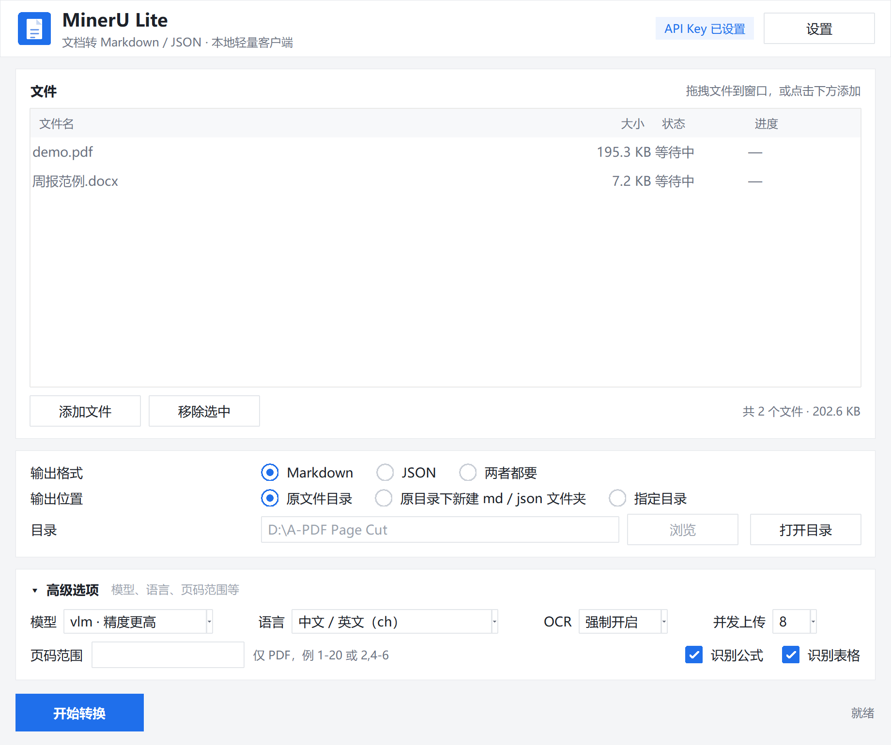

# MinerU Lite

一个轻量的 MinerU 文档转换客户端：选文件 → 选输出位置 → 导出 Markdown 或 JSON。

单文件 exe，约 11.7 MB，不依赖 Python、Node 或 MCP 进程，双击即用。

**下载**：[Releases](https://github.com/NaClLuo/mineru-lite/releases/latest) → `MinerU-Lite-1.0.0.exe`



## 用法

1. 双击 `dist/MinerU Lite.exe`
2. 添加文件：拖拽到窗口、点「添加文件」，或把文件直接拖到 exe 图标上
3. 选择输出格式（Markdown / JSON / 两者）与输出位置
4. 点「开始转换」

转换过程中每个文件显示实时状态：排队、上传百分比、已解析页数 / 总页数、完成或失败原因。可以随时取消。

## 输出规则

| 输出位置 | 结果 |
| --- | --- |
| 原文件目录 | 与源文件同层，生成 `报告.md`、`报告_content_list.json` |
| 原目录下新建文件夹 | md 进 `md/`，json 进 `json/`，源文件所在目录保持干净 |
| 指定目录 | 全部输出到指定目录 |

输出目录输入框默认填入第一个文件的来源目录。同名文件已存在时自动追加 `_1`、`_2`，不会覆盖。输出卡片上的「打开目录」按钮可一键打开当前生效的目录。

## 支持的格式与限制

- 格式：PDF、DOC、DOCX、PPT、PPTX、XLS、XLSX、PNG、JPG、JPEG、JP2、WEBP、GIF、BMP
- 单文件 ≤ 200 MB、≤ 200 页
- 单批最多 50 个文件，超出自动分批
- 文件会上传到 mineru.net 云端解析，敏感文档请自行判断

## API Key

- 在「设置」窗口中填写，可点「测试连接」当场验证
- 首次启动会尝试从本机已有的 MCP 配置（如 `~/.workbuddy/mcp.json`）自动读取，读取不到再手动填
- 保存在 `%APPDATA%\MinerU Lite\config.json`，只存在本机

## 没有 API Key 时：免费模式

不填 Key 也能用，程序会自动走 MinerU 的免费接口（Flash）。限制写死在服务端：

- 单文件 ≤ 10 MB、≤ 20 页
- 只输出 Markdown，JSON 选项会被锁掉
- 逐文件处理，模型与并发设置不生效（界面会置灰）

界面上角会显示「免费模式 · 仅 Markdown」。超过 10 MB 的文件会直接提示，需要填 Key 才能处理。

## 大文件为什么不再卡住

MinerU 返回的结果压缩包里除了 `full.md` 和 `content_list.json`，还塞了 `origin.pdf`、`layout.pdf` 和整页图片，体积常常和原文件相当。以一份 47 MB 的 PDF 为例：结果包 47.9 MB，整包下载约 286 秒，而真正需要的两个文件只有几十 KB。

程序现在读取 zip 中央目录后，用 HTTP Range 只抓这两个成员，同一个文件降到约 4 秒；服务端不支持范围请求时自动回退为整包下载，并在界面上显示真实百分比。

## 高级选项

| 选项 | 说明 |
| --- | --- |
| 模型 | `vlm` 精度更高（默认）；`pipeline` 速度更快 |
| 语言 | OCR 语种，默认中文 + 英文 |
| OCR | 自动判断 / 强制开启（扫描件） / 关闭 |
| 并发上传 | 同时上传的文件数，默认 4 |
| 页码范围 | 仅对 PDF 生效，如 `1-20`、`2,4-6`，留空为全文 |
| 识别公式 / 表格 | 对应 MinerU 的 `enable_formula` / `enable_table` |

## 已知取舍

- **不保存图片**：按「仅 md 单文件」的设定，`images/` 不落地，所以 md 里的图片链接、JSON 里的 `img_path` 指向的图片不会存在。需要完整资源包时告诉我，加个开关即可。
- 解析仍在云端排队，扫描件长文档耗时主要在解析阶段（47 MB / 21 页约 40 秒），下载已经不再是瓶颈。
- 单文件 exe 首次启动要解压到临时目录，约 1 秒。
- 部分杀毒软件对 PyInstaller 打包的 exe 会误报，属于常见现象。

## 代码结构

```
src/app.py             界面、队列调度、打包入口（含 --selftest 自检）
src/mineru_client.py   官方 API 客户端，仅用标准库
src/config.py          配置读写与 API Key 自动发现
build.py               打包脚本
tools/                 开发期工具：图标生成、截图、拖拽与端到端测试
```

接口直连 `https://mineru.net/api/v4`，与 `mineru-open-mcp` 调用的是同一套服务：申请上传链接 → 直传文件 → 轮询批任务 → 下载结果包取 `full.md` 与 `*_content_list.json`。

拖拽走 Windows 的 OLE `IDropTarget`（与资源管理器同一套机制），不钩 Tk 的窗口过程；回调里只把路径入队，由 Tk 主循环添加文件。若拖拽功能在个别机器上不可用，可以设环境变量 `MINERU_LITE_NO_DND=1` 关掉它，文件选择按钮不受影响。

## 重新打包

```bat
python -m venv .buildenv
.buildenv\Scripts\pip install pyinstaller
.buildenv\Scripts\python build.py
```

脚本会自动处理虚拟环境下的 Tcl/Tk 路径问题，产物输出到 `dist\`。

自检（不打开界面，直接转换一个文件）：

```bat
dist\MinerU Lite.exe --selftest 样本.pdf 输出目录
```
